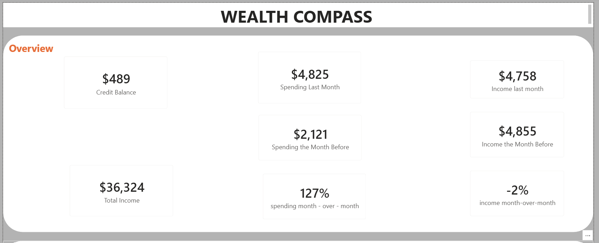
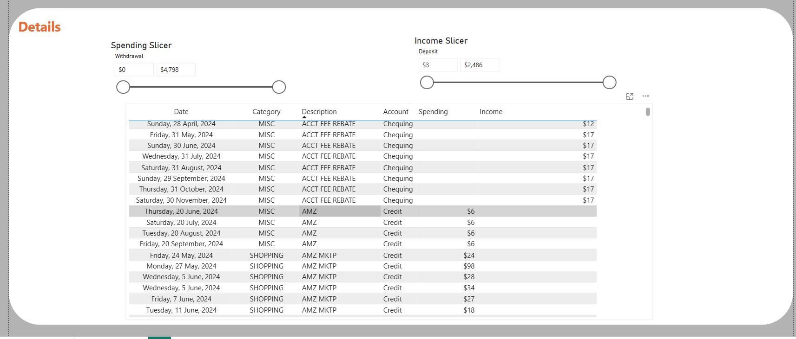

# Wealth Compass: Personal Finance Dashboard (Power BI)

A Power BI dashboard that tracks income, spending and balances from 9 months of bank and credit card transactions (April to December 2024), to answer one question: **where is the money going, and is it under control?**

## Dashboard sections
1. **Overview:** KPI cards for total income, credit balance, last month's spending and income, and month-over-month change
2. **Month-by-Month Breakdown:** spending vs income by month, with chequing balance and total spending
3. **Spending Breakdown:** spending by category (treemap), top merchants, and favourite restaurants
4. **Income Breakdown:** income by category and a table of income sources with frequency
5. **Details:** a full transaction table with spending and income range slicers for drill-down

## Key insights
- **Total income was $36,324 against $20,877 of spending**, a savings rate of about 42%.
- **Spending jumped 127% month-over-month** in November ($2,121 to $4,825), while income dipped 2%. November spending nearly matched that month's income.
- **Shopping ($8,250) and Misc ($7,806) make up 77% of all spending.** The large Misc share comes from uncategorised and one-off transactions, so better categorisation is the first fix.
- **Apple ($3.4K) is the largest single merchant**, ahead of Walmart ($1.7K) and Amazon ($1.3K).
- **96% of income comes from a single source** (salary), so there is little income diversification.

## Recommendations
- Set a monthly spending cap and alert when month-over-month spending rises sharply.
- Re-categorise Misc transactions to see the real spending picture.
- Review large one-off purchases before they happen, since they drive the monthly spikes.

## Technical notes
- Data cleaned and typed in **Power Query**.
- **DAX** measures for KPIs and month-over-month change.
- December 2024 is a partial month (data ends 8 Dec), so a DAX table finds the latest date per account and the month-over-month cards compare the last two complete months.

## Files
- `Wealth Compass.pbix`: Power BI dashboard
- `transactions.xlsx`: transaction dataset

## Screenshots

